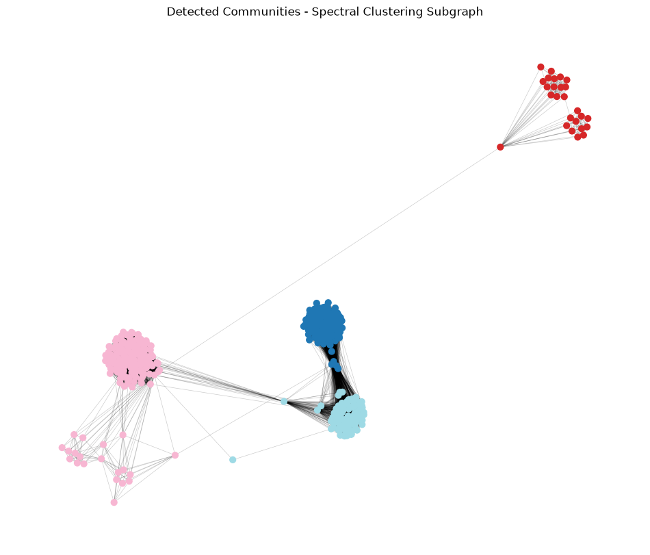
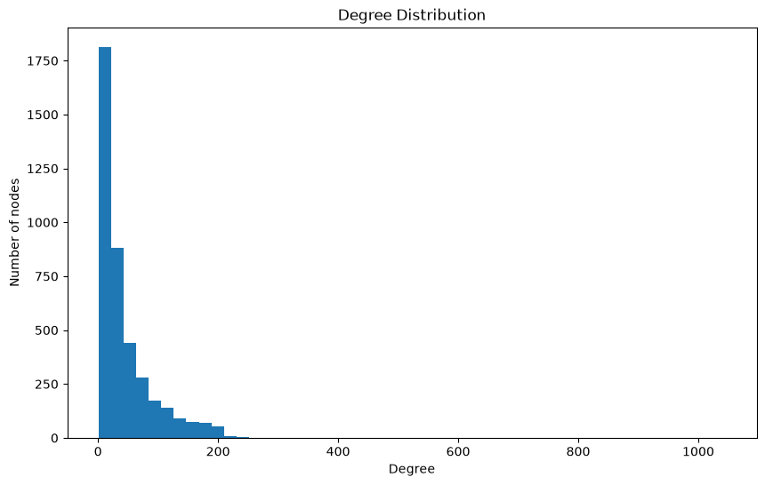
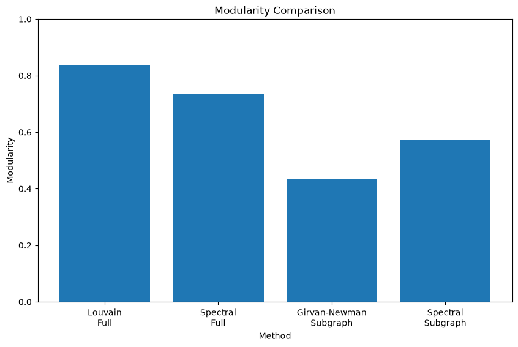

# Community Detection on the Facebook Social Graph

Structural analysis and community detection on the SNAP Facebook ego-network: 4,039 users and 88,234 friendships. The project compares three algorithms (Louvain, Girvan–Newman and spectral clustering) by the modularity and conductance of the communities they find.



## The graph

| Property | Value |
|:--|--:|
| Nodes / edges | 4,039 / 88,234 |
| Density | 0.0108 |
| Average degree | 43.7 (min 1, max 1,045) |
| Average clustering coefficient | 0.606 |
| Connected components | 1 |

The graph is sparse: about 1% of possible friendships exist. Yet it is highly clustered: on average, 61% of the pairs among a user's friends are also friends with each other. That combination of local density and global sparsity is typical of social networks, and it is what makes clear community structure possible.



The degree distribution is heavy-tailed. 71% of users have fewer than 50 friends (median 25), while a few hubs have hundreds. The hubs also top the betweenness and closeness rankings: node 107 has degree 1,045, betweenness 0.48 and the highest closeness. These hubs are mostly the "ego" users the dataset was collected around, and they act as bridges between otherwise separate friend circles.

The script also reports degree, betweenness, eigenvector and closeness centrality for the top 10 nodes.

## Methods

| Algorithm | Approach | Applied to |
|:--|:--|:--|
| **Louvain** | Greedy modularity optimisation that merges nodes into communities level by level | Full graph |
| **Spectral clustering** | Embeds nodes using eigenvectors of the graph Laplacian, then groups them with k-means | Full graph (k = 16, matching Louvain) and subgraph (k = 4) |
| **Girvan–Newman** | Repeatedly removes the edge with the highest betweenness until the graph splits into k parts | Subgraph only (k = 4) |

Girvan–Newman recomputes edge betweenness after every removal, which makes it far too slow for the full graph. It runs on a subgraph instead: the 500 highest-degree users, restricted to their largest connected component, which leaves 497 nodes and 27,237 edges. Spectral clustering runs on the same subgraph with the same k, so the two can be compared directly.

**Metrics:**
- **Modularity** (higher is better) measures how many more edges fall inside communities than a random graph with the same degrees would have.
- **Average conductance** (lower is better) measures the share of each community's edges that leave the community.

The dataset has no ground-truth communities for the combined graph, so external measures such as the Rand index cannot be used.

## Results

| Graph | Algorithm | Communities | Modularity | Avg. conductance |
|:--|:--|--:|--:|--:|
| Full | **Louvain** | 16 | **0.8349** | **0.0543** |
| Full | Spectral clustering | 16 | 0.7331 | 0.0581 |
| Subgraph | Girvan–Newman | 4 | 0.4365 | 0.0407 |
| Subgraph | **Spectral clustering** | 4 | **0.5721** | **0.0203** |



- **Full graph: Louvain wins.** It reaches modularity 0.83, better than spectral clustering on both metrics. That's expected, since Louvain directly optimises modularity. Its communities are also more balanced: the largest Louvain community has 548 users, while spectral clustering lumps 897 users into one cluster.
- **Subgraph: spectral clustering beats Girvan–Newman.** It finds tighter, better-separated communities (modularity 0.57 vs 0.44, conductance half as high). It is also far faster: under a second, against about 6 minutes for Girvan–Newman.
- **No single best algorithm.** The right choice depends on graph size and compute budget. Louvain scales to the full network, Girvan–Newman produces an interpretable split hierarchy but only works on small graphs, and spectral clustering needs k chosen in advance.

### Choosing k for Girvan–Newman

The number of communities was chosen by running Girvan–Newman on the subgraph with k = 2 to 5:

| k | Community sizes | Modularity | Avg. conductance |
|--:|:--|--:|--:|
| 2 | 471, 26 | 0.0114 | 0.0032 |
| 3 | 186, 285, 26 | 0.4353 | 0.0019 |
| **4** | 166, 285, 20, 26 | **0.4365** | 0.0407 |
| 5 | 1, 285, 165, 20, 26 | 0.4365 | 0.2326 |

k = 4 gives the best modularity. Going to k = 5 only splits off a single node, adds no modularity and takes much longer to run. To repeat the sweep, change `k` in the `run_girvan_newman` call in `main()`.

## Project structure

```
community_detection.py   graph analysis, the three algorithms, comparison and plots
data/                    SNAP Facebook combined edge list
outputs/                 generated plots
```

## Getting started

Requires Python 3.12.

```bash
python -m venv .venv
source .venv/bin/activate        # Windows: .venv\Scripts\activate
pip install -r requirements.txt
python community_detection.py
```

The script prints all statistics and the comparison tables to the console and writes the plots to `outputs/`. A full run takes about 10 minutes, most of it spent on Girvan–Newman and exact betweenness centrality.

## Managing dependencies

Top-level dependencies are listed in `requirements.in` and pinned with [pip-tools](https://github.com/jazzband/pip-tools):

```bash
pip install pip-tools
pip-compile --strip-extras requirements.in -o requirements.txt
```

## Credits

Data: [Social circles: Facebook](https://snap.stanford.edu/data/ego-Facebook.html) from the Stanford Network Analysis Project, by J. McAuley and J. Leskovec, "Learning to Discover Social Circles in Ego Networks", NIPS 2012. User identities are anonymised.

Originally built as a university assignment for an MSc course on data mining and analysis.

## License

The code is released under the [MIT License](LICENSE). The dataset in `data/` is third-party content from SNAP and is not covered by the MIT License.
